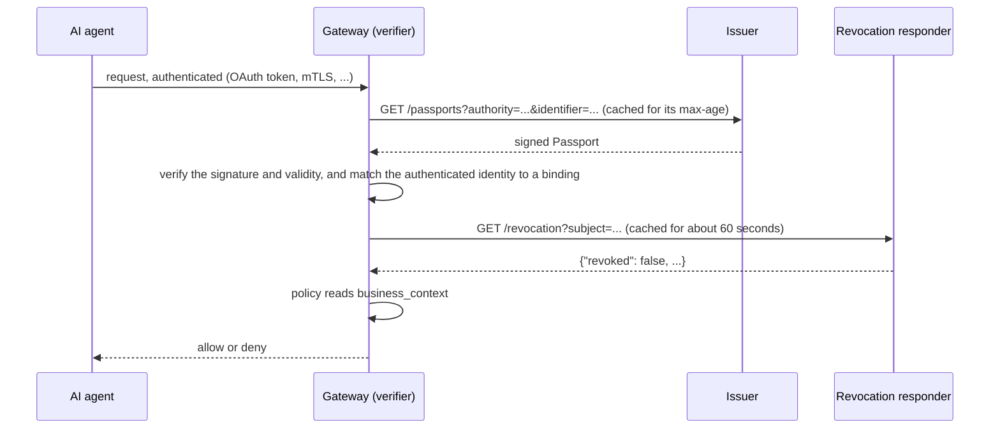

# AI Passport

Organisations control their AI agents with policy. But a policy can only test what it is
given, and the request does not say who answers for an agent, what it is for or how risky
it is. What a rule does when a value is missing or an error occurs is decided engine by
engine and rule by rule, so the same agent can be denied at one gateway and allowed at the
next. When an agent's owner leaves or its approval is withdrawn, someone has to edit rules
everywhere.

AI Passport gives every gateway and policy engine the same inputs, in the same shape:

- **A Passport**: a signed document about an AI asset, built from the organisation's own
  records. It says who answers for the asset (its owner and manager), where it sits in the
  organisation, who built it, how risky it is assessed to be, and what it is for.
- **A revocation check**: one HTTP call that says whether the asset may still act. Unable to
  ask means deny.

Revocation follows the business context. When the last manager of an agent leaves, or
governance withdraws its approval, the issuer revokes it. Every gateway that checks then
denies, within the short time it may reuse its last answer, and nobody edits a rule.

This release covers the Passport format and revocation of an asset as a whole.
Constraint-based checks, which say what an asset may do, are planned for a later release.

## Get started

You don't need to read everything. Pick what you are building:

| You are building | Read first | Then |
|---|---|---|
| A gateway or policy engine that checks agents | §1 of each spec, about 10 minutes | Start from [conformance/examples/gateway_check.py](conformance/examples/gateway_check.py), about 50 lines, then test your code with `python3 conformance/run.py --role verifier --adapter …` |
| A revocation endpoint | Revocation Check §1 and §5 | `python3 conformance/run.py --role responder --url https://…/revocation` |
| A system that issues Passports | Passport §1, §3 and §8 | Verify your Passports with a verifier that passes the suite |
| Nothing yet, just evaluating | this page and [AT_A_GLANCE.md](AT_A_GLANCE.md), 5 minutes | [FAQ.md](FAQ.md): how this relates to JWT, OAuth, SPIFFE, Verifiable Credentials and policy engines |

The rest of each spec is reference. When the suite fails a case, the case names the section
it tests: read that section then.

## How it works



A policy then reads business context like any other input. For example, in Rego:

```rego
package gateway

import rego.v1

default allow := false

ctx := input.passport.business_context

allow if {
    input.revocation.revoked == false
    count(input.revocation.revoked_scopes) == 0
    ctx.risk_classification.value in {"low", "medium"}
}
```

An absent or `unassessed` risk classification never passes, because an attribute that is
missing reads as its least favourable value. The example is informative; the specifications
define no policy language.

## The specifications

- **AI Passport v1** ([spec/passport-v1.md](spec/passport-v1.md)): the signed document, its
  business context, and how a verifier checks it.
- **AI Passport Revocation Check v1** ([spec/revocation-check-v1.md](spec/revocation-check-v1.md)):
  `GET /revocation?subject=…`, and what each answer means.

A v1 Passport may carry personal data, such as people's names. Where it does, it is served
only to authenticated callers. The revocation check never carries personal data.

The specs define an interface only. How an issuer derives business context, and when it
decides to revoke, is out of scope and stays in each implementation.

## Who is behind it

AI Passport is drafted by the AI Platform Security team at ServiceNow and published under
an open licence, so that anyone can issue and verify Passports. The `purpose` vocabulary
started from the AI asset classification in ServiceNow Super Intelligence Control Tower. It
is maintained here and changes only as [GOVERNANCE.md](GOVERNANCE.md) describes. We want other issuers
and verifiers to try it: open an issue with what works and what does not.

ServiceNow is building an issuer for AI Passports. When it becomes available, any gateway or
policy engine that implements these specifications can point at its Passport and
revocation endpoints with no other integration. Watch this repository (Releases) for news.

## Layout

| Path | Contents | State |
|---|---|---|
| `spec/` | the two specifications | draft |
| `conformance/` | the conformance suite: `run.py`, which tests a verifier, caller or responder through a small adapter, plus a reference adapter and server, and `examples/` | draft |
| `conformance/vectors/` | 155 test vectors (81 Passport verification, 33 responder, 41 caller), the test JWKS, and the generator | draft |
| `LICENSE.md` | which licence applies where: Community Specification License 1.0 for the specifications, Apache License 2.0 for code and test data | |
| `SCOPE.md`, `NOTICES.md`, `GOVERNANCE.md` | the Scope of the patent commitment, notices under the licence, and how a draft becomes approved | |
| `AT_A_GLANCE.md`, `FAQ.md` | one-page summary, and how AI Passport relates to other work | draft |
| `VERSIONING.md` | how versions are numbered and what never changes | draft |
| `CONTRIBUTING.md`, `SECURITY.md`, `CHANGELOG.md` | project process | draft |
| `AGENTS.md`, `llms.txt` | instructions for coding agents, and an index of the docs for language models | draft |

Planned: JSON Schemas and an OpenAPI description of the revocation check.

## Testing an implementation

```
python3 conformance/run.py --selftest                                   # the suite checks itself
python3 conformance/run.py --role verifier --adapter "ADAPTER_COMMAND"  # or caller, responder
python3 conformance/vectors/generate.py --check                         # the vector files
```

Standard library only. An adapter is a small command that connects your code to the
runner; see [conformance/README.md](conformance/README.md).

## Licences

The specifications are under the Community Specification License 1.0: anyone can implement
them royalty-free. Code and test data in `conformance/` are under the Apache License 2.0.
See [LICENSE.md](LICENSE.md).

## Versioning

The specs are drafts and will change before implementations reach general availability.
After that, changes are additive, and a breaking change arrives only in a new major version.
No change makes a conforming verifier allow something an earlier version denied. See
[VERSIONING.md](VERSIONING.md).
